<p align="center"></p>

# breach-wire

**One line per cyber attack, three times a day.** Breach Wire watches ransomware leak sites, dark-web forums, Telegram, the security press, mainstream news and SEC filings. It writes what it finds to [breach-wire.md](breach-wire.md) as short messages:

```
DATE | STATUS | TTP [ATT&CK] | COMPANY (country, sector) | Stolen: what (volume) | via sources
2026-11-16 | CONFIRMED | Third-party/trusted relationship [T1199] | Infoblox | Stolen: customer data, employee/HR data | via Security Affairs, The Register, TechCrunch
2026-11-17 | CLAIMED | Exfiltration + extortion [T1657] - Vortex | Apellis Pharmaceuticals (US, Healthcare) | Stolen: data (307.64 GB) | via ransomware.live, RansomLook
```

## What's new

- **Runs on GitHub Actions** three times a day, at a different time each day. No laptop needed.
- **Stays inside the free tier:** about 360 Actions minutes a month, against 2,000 free.
- **19 sources**, all confirmed working from GitHub's runners.

## Status

| | |
|---|---|
| **CONFIRMED** | The victim, a regulator or an SEC 8-K Item 1.05 filing acknowledges it |
| **REPORTED** | Credible press reports it; the victim hasn't confirmed yet (upgraded once they do) |
| CLAIMED | A leak site, dark-web forum or Telegram post claims it. Unverified |

## Sources

[sources.json](sources.json) lists them all. Disable one with `"enabled": false`.

- **Dark web:** ransomware.live, RansomLook (leak-site trackers), Dark Web Informer (forum claims)
- **Telegram:** RansomFeedNews, cyber_security_channel
- **Security press:** BleepingComputer, The Hacker News, The Record, SecurityWeek, DataBreaches.net, Security Affairs, Dark Reading, The Register, TechCrunch
- **News:** Reuters, AP, The Guardian, BBC
- **Filings:** SEC 8-K Item 1.05

## Schedule

The [workflow](.github/workflows/breach-wire.yml) runs in three UTC windows: **06:00–07:30, 13:00–14:30 and 20:00–21:30**. Each day it picks one start time per window. To run it now, go to **Actions → breach-wire → Run workflow**.

To run it locally:

```bash
pwsh scripts/Get-BreachWire.ps1 -Days 7 -NoClaims
```

## Caveats

- **The TTP and "stolen" columns are keyword-derived.** Use them for triage, not attribution.
- **Only data types and volumes are recorded.** Leaked values are never copied into the feed.
- **Leak-site claims are noisy.** Groups re-post old victims and inflate volumes.
- **`?` means no company could be parsed** from the headline; follow the source link.
